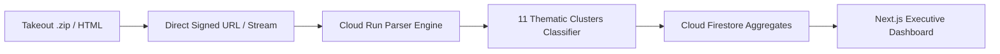

# Google Takeout Search Activity Parser & Executive Dashboard

A full-stack, enterprise-grade analytical platform that ingests decades of Google Takeout search activity archives (`.zip` exports containing `MyActivity.html` or `MyActivity.json`), stream-parses 100k+ historical records with $O(1)$ memory, categorizes queries into thematic clusters via a hybrid rule engine and Gemini GenAI fallback, stores pre-aggregated metrics in Google Cloud Firestore, and renders an interactive Executive Dashboard mirroring our 20-year Google Sheets analytical model (2007–2026).

---

## 1. Architectural Highlights



- **Streaming Ingestion**: Parses 66MB+ `MyActivity.html` and large `.zip` files record-by-record using SAX event streams (`htmlparser2`), eliminating memory bottlenecks.
- **Classification Engine**: Instant regex categorizer covering 11 core longitudinal domains + optional `@google/genai` (Gemini Flash) batch fallback.
- **Pre-Aggregated Firestore Storage**: Eliminates high-cost document scans by computing summaries, decade shifts, yearly metrics, and top cluster rolls into Firestore subcollections (`users/{uid}/dashboards/*`).
- **Decade-over-Decade Behavioral Analysis**: Quantifies the transition from the **Discovery Era (2007–2016)** to the **Targeted Utility Era (2017–2026)**, highlighting the **-46.6% drop in Search-to-Click ratio** (Zero-Click SERP resolution).

---

## 2. Directory Structure

```
greader/
├── web/                     # Next.js 14 App Router (Tailwind CSS, Lucide, Recharts)
│   ├── src/
│   │   ├── app/             # Main Executive Dashboard page & dark layout
│   │   ├── components/      # Scorecards, Decade Table, Charts, Qualitative Cards
│   │   └── lib/             # Client streaming parser & POC reference analytical data
│   └── Dockerfile           # Next.js standalone container
├── server/                  # Node.js TypeScript API & Cloud Run Worker
│   ├── src/
│   │   ├── config/gcp.ts    # Google Cloud Storage, Firestore & Gemini SDK
│   │   ├── routes/          # /upload-url, /process-gcs, /parse-direct, /dashboard
│   │   ├── services/        # SAX Streaming Parser & Rule/Gemini Classifier
│   │   └── aggregator.ts    # Firestore batch calculation & rollup
│   └── Dockerfile           # Express / Fastify worker container
├── deploy/
│   ├── cloudbuild.yaml      # Automated Cloud Build & Cloud Run deployment pipeline
│   ├── gcs-lifecycle.json   # 24-hour TTL for uploaded raw zips (privacy compliance)
│   └── firestore.rules      # Multi-tenant security rules
└── README.md
```

---

## 3. Local Development

### Prerequisites
- Node.js 20+ (v22 recommended)
- npm 10+

### Step 1: Start the Server (Port 8080)
```bash
cd server
npm install
npm run dev
```
Endpoints:
- `POST /api/upload-url`: Generates GCS signed upload URL.
- `POST /api/parse-direct`: Multipart streaming upload & parser.
- `GET  /api/dashboard/:uid`: Pre-aggregated dashboard.
- `GET  /api/sample-data`: Reference 70k analytical dataset.

### Step 2: Start the Web App (Port 3000)
```bash
cd web
npm install
npm run dev
```
Open [http://localhost:3000](http://localhost:3000) to view the Executive Dashboard.

---

## 4. Google Cloud Platform Deployment

### 1. Setup GCS Bucket with 24-Hour TTL
```bash
# Create bucket
gsutil mb -l us-central1 gs://your-project-takeout-uploads

# Apply 24-hour TTL lifecycle rule
gsutil lifecycle set deploy/gcs-lifecycle.json gs://your-project-takeout-uploads
```

### 2. Deploy with Cloud Build
```bash
gcloud builds submit --config=deploy/cloudbuild.yaml
```

---

## 5. Reference Analytical Model Verification (70,023 Items)
- **Total Logged Items**: 70,023
- **Google Searches**: 44,530 (63.6%)
- **Visited Web Pages**: 24,993 (35.7%)
- **Account Notifications**: 320 (0.5%)
- **Viewed Entity / Cards**: 215 (0.3%)
- **Zero-Click Shift**: Search-to-Click ratio plummeted from **0.61 down to 0.33 (-46.6%)**, demonstrating Google's transition into an instant answer engine.
